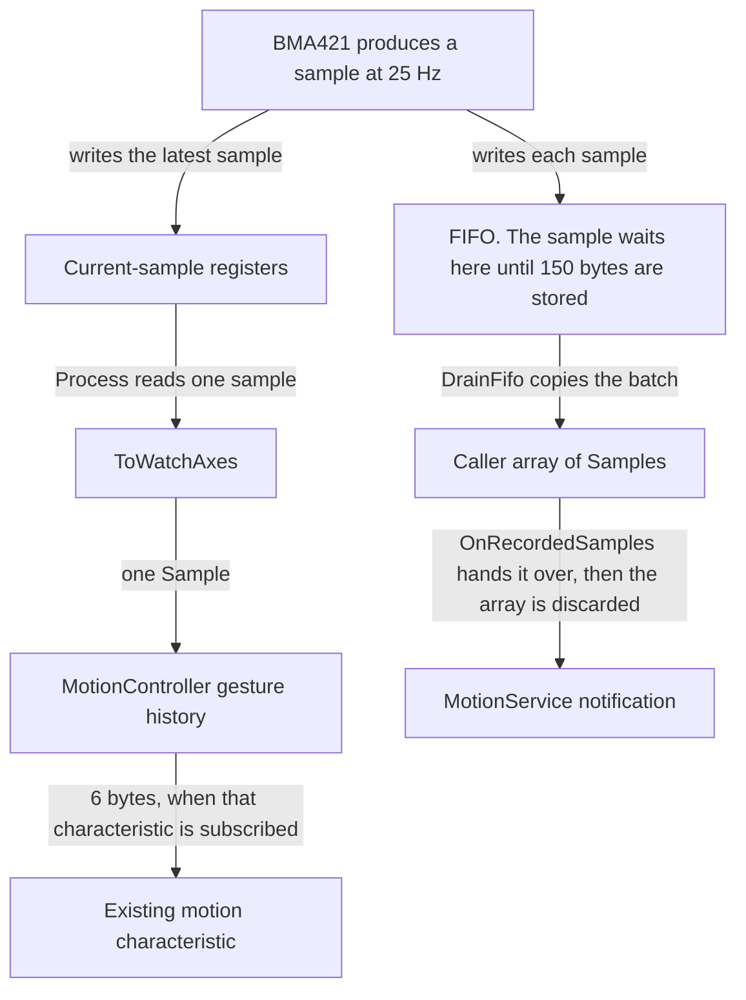
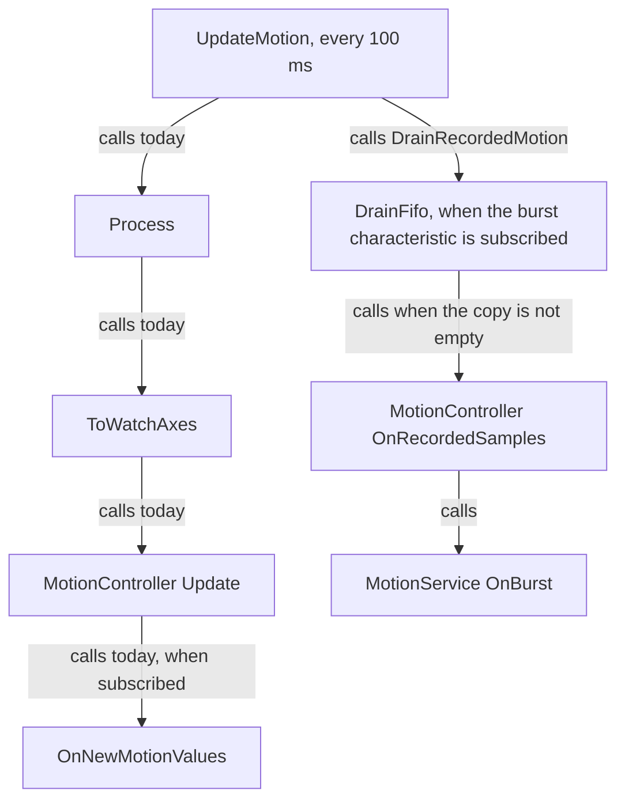

# Accelerometer FIFO

The BMA421 records samples into its FIFO. `DrainFifo` copies them out once 150 bytes are waiting. Source: [src/drivers/Bma421.cpp](../src/drivers/Bma421.cpp).

Gesture wake still uses one fresh sample from `Process`. Tap wake uses the touch controller and does not read this sensor.

## Status

| Piece | State | Where |
|---|---|---|
| 25 Hz, FIFO enabled, 150-byte watermark | Written | `Bma421::Init` |
| `ToWatchAxes` | Written | `Bma421` |
| `DrainFifo` | Written | `Bma421::DrainFifo` |
| Call `DrainFifo` every 100 ms while the burst characteristic is subscribed, or while the accel screen is open | Written | `SystemTask::DrainRecordedMotion` |
| Forward the batch without touching gesture history | Written | `MotionController::OnRecordedSamples` |
| Show the newest FIFO sample beside the live sample | Written | `Screens::AccelCheck` |
| Send the batch, then drop the local array | Written | `MotionService::OnBurst` |

`MotionService` does not read the chip. It sends the array it is given.

The launcher’s first icon opens Accel check. While that screen is open, the FIFO is drained even with no phone connected. The screen shows the live sample and the newest sample of the last batch. 1024 counts is 1 g. Leaving the screen stops that extra drain.

## Flow

An arrow in the first diagram is a sample moving from one place to the next. An arrow in the second diagram is one function calling another. The two are separate, so a line never means both at once.

### Where a sample moves

While the FIFO holds fewer than 150 bytes, the sample stays in the FIFO. That wait is not an arrow. The arrow appears when `DrainFifo` copies the batch out.

After the copy, the chip no longer has those samples. They live in the caller’s array until `OnBurst` sends them, and the watch does not keep another copy. Samples that arrive afterward go back into the FIFO and wait for the next time the line is reached.

### Which function calls the next

## Contract

| Name | Kind | Meaning |
|---|---|---|
| `Sample` | Struct, 6 bytes | One reading in watch axes. `x`, `y`, `z` are `int16`. 1024 counts is 1 g. `x` is the chip's Y and `y` is the chip's X. |
| `Values` | Existing struct | One live reading: `steps` plus axes copied from a `Sample`. |
| `rawX`, `rawY`, `rawZ` | Arguments | Chip axis order, before the swap in `ToWatchAxes`. |
| `scale` | Lookup | Counts per g for the active range. At ±2 g this is 1024, so the stored count equals the raw count. |
| `accel_conf.odr` | Sensor setting | `BMA4_OUTPUT_DATA_RATE_25HZ`. |
| `fifoWatermarkBytes` | Constant, 150 | `DrainFifo` returns 0 until the FIFO holds at least this many bytes. |
| `samples` | Caller array | Destination for drained frames. The caller owns it. |
| `capacity` | Count | Slots in `samples`. A return equal to `capacity` means frames may still be waiting. Pass at least 25. |
| `available` | Byte count | FIFO fill level at the start of the call. |
| `burstSampleCapacity` | Constant, 25 | Most samples one notification and one stack array can hold. |
| `firstSampleMs` | `uint32` | Milliseconds since boot of the oldest sample in the notification. The newest sample is the drain time. Each older sample is 40 ms earlier. |
| Burst notification | Bytes, little-endian | `uint8 count`, then `uint32 firstSampleMs`, then `count` samples (`int16 x`, `y`, `z` in watch axes). Characteristic `00030003-78fc-48fe-8e23-433b3a1942d0`, notify only. |

A notification of 25 samples is 155 bytes, and it needs an MTU of at least 158 (the 3-byte ATT notify header included). When the link MTU is smaller, `OnBurst` splits the batch into several notifications. Each notification holds as many samples as the MTU allows (at most 25), and each one carries its own `firstSampleMs`, so the phone can still place every sample at the right time. Samples are never dropped for MTU reasons.

`Init` also selects headerless accelerometer frames, filtered data, no extra downsampling, and stop-on-full. Stop-on-full keeps a late drain from wrapping the 1 KB buffer. Averaging mode (`BMA4_CIC_AVG_MODE`) is unchanged.

## Internals

| Name | Kind | Meaning |
|---|---|---|
| `fifoReadChunkBytes` | Constant, 96 | Largest read in one transfer: 16 frames. The vendor read copies the request onto the stack. The system task stack is 350 words. |
| `chunk` | Byte count | This transfer. Capped by 96, by the remaining capacity, and rounded down to a multiple of 6. |
| `raw` | 96-byte buffer | Unparsed bytes for one chunk. |
| `frame` | Bosch descriptor | Points at `raw` for `bma4_read_fifo_data`. |
| `parsed` | Chip frames | Up to 16 triples in chip axis order, before `ToWatchAxes`. |
| `written` | Count | Frames stored in this call. This is the return value. |
| `fifoDrainContinues` | Flag | Set when the caller array filled and whole frames remain. The next `DrainFifo` copies those frames even though the FIFO is under 150 bytes. |

## Timing

The task checks every 100 ms. The FIFO is drained when it reaches 150 bytes. A frame is 6 bytes, so that is 25 samples. At 25 Hz, 25 samples is 1 second. The burst leaves within one 100 ms check of crossing the watermark.
